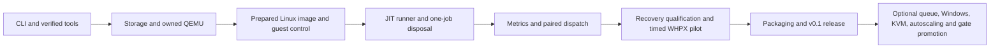

# Runloc implementation programme

Reviewed 17 October 2026. **Planning complete; runtime implementation not started.**
The owner selected Linux runners first on Windows/WHPX, Windows guests later.
Runloc's own source/docs use MIT. Read [AGENTS](../../AGENTS.md),
[scope](../rag/00-SCOPE.md), [RAG index](../rag/README.md) and
[review/revisions](PLAN-REVIEW.md) before beginning an issue.

## Delivery boundary

V0.1 is RUNLOC-001 through RUNLOC-014: a small Python CLI, clean image/toolchain, safe
one-job VM lifecycle, API-bound GitHub execution, bounded evidence/stats,
independent hosted/private comparisons, failure recovery, real WHPX timing and
a reproducible release. RUNLOC-015–019 are separately gated follow-ons. Do not implement
every future feature before shipping the accepted one-job product.

## Issues and dependencies

Numbers follow a valid topological order. Independent branches can progress once
their own dependencies are accepted; numbering is not a requirement to serialize
unrelated work. Each live issue contains its complete autonomous execution prompt,
links to instructions/RAG, scoped deliverables, observable acceptance, tests,
exclusions, prerequisites and PR/merge/post-merge gates.

| Issue | Deliverable | Depends on | Stage | Status |
|---|---|---|---|---|
| [RUNLOC-001](https://github.com/techrote/runloc/issues/1) | Establish the CLI, schemas and deterministic product test harness | — | v0.1 | planned |
| [RUNLOC-002](https://github.com/techrote/runloc/issues/2) | Implement fail-fast host doctor and verified local tool acquisition | RUNLOC-001 | v0.1 | planned |
| [RUNLOC-003](https://github.com/techrote/runloc/issues/3) | Implement lease reservations and one-level disposable QCOW2 storage | RUNLOC-002 | v0.1 | planned |
| [RUNLOC-004](https://github.com/techrote/runloc/issues/4) | Own QEMU launch, QMP and bounded Windows process lifetime | RUNLOC-002, RUNLOC-003 | v0.1 | planned |
| [RUNLOC-005](https://github.com/techrote/runloc/issues/5) | Build and qualify a credential-free Linux runner image recipe | RUNLOC-002, RUNLOC-004 | v0.1 | planned |
| [RUNLOC-006](https://github.com/techrote/runloc/issues/6) | Establish authenticated per-lease guest readiness and control | RUNLOC-004, RUNLOC-005 | v0.1 | planned |
| [RUNLOC-007](https://github.com/techrote/runloc/issues/7) | Implement host-only GitHub auth and repository-scoped JIT runners | RUNLOC-001, RUNLOC-006 | v0.1 | planned |
| [RUNLOC-008](https://github.com/techrote/runloc/issues/8) | Orchestrate one real job through collection and complete disposal | RUNLOC-003, RUNLOC-004, RUNLOC-006, RUNLOC-007 | v0.1 | planned |
| [RUNLOC-009](https://github.com/techrote/runloc/issues/9) | Expose bounded evidence receipts and read-only terminal performance stats | RUNLOC-001, RUNLOC-008 | v0.1 | planned |
| [RUNLOC-010](https://github.com/techrote/runloc/issues/10) | Dispatch independent hosted/private comparisons with offline fallback | RUNLOC-007, RUNLOC-008, RUNLOC-009 | v0.1 | planned |
| [RUNLOC-011](https://github.com/techrote/runloc/issues/11) | Qualify crash recovery, cancellation and failure cleanup | RUNLOC-008, RUNLOC-009, RUNLOC-010 | v0.1 | planned |
| [RUNLOC-012](https://github.com/techrote/runloc/issues/12) | Run the clean timed WHPX pilot and publish a go/no-go assessment | RUNLOC-005, RUNLOC-010, RUNLOC-011 | v0.1 | planned |
| [RUNLOC-013](https://github.com/techrote/runloc/issues/13) | Package the CLI and document a clean on-demand runner quickstart | RUNLOC-010, RUNLOC-011, RUNLOC-012 | v0.1 | planned |
| [RUNLOC-014](https://github.com/techrote/runloc/issues/14) | Close the v0.1 release gate with whole-programme evidence | RUNLOC-011, RUNLOC-012, RUNLOC-013 | v0.1 | planned |
| [RUNLOC-015](https://github.com/techrote/runloc/issues/15) | Add a bounded foreground multi-lease queue and resource admission | RUNLOC-014 | follow-on | planned |
| [RUNLOC-016](https://github.com/techrote/runloc/issues/16) | Evaluate Windows guest runners and nested-virtualization limits | RUNLOC-014 | follow-on | planned |
| [RUNLOC-017](https://github.com/techrote/runloc/issues/17) | Qualify a Linux/KVM host backend with the same lease contract | RUNLOC-014 | follow-on | planned |
| [RUNLOC-018](https://github.com/techrote/runloc/issues/18) | Evaluate official scale-set integration and future CI-provider adapters | RUNLOC-014, RUNLOC-015 | follow-on | planned |
| [RUNLOC-019](https://github.com/techrote/runloc/issues/19) | Design and qualify private-result promotion with hosted fallback | RUNLOC-010, RUNLOC-012, RUNLOC-014 | follow-on | planned |

## Tracking and execution

[issues.json](issues.json) is the canonical machine-readable catalogue. The
[issue mirrors](issues/) are deterministic reviewable copies of the published
bodies. `python scripts/render_programme.py` regenerates them after an intentional
catalogue update. `python scripts/check_repository.py` checks graph/doc/prompt
consistency without API access. Live issue comments can clarify scope; reconcile
material changes back into these contracts in the implementation PR.

No runloc runtime command, physical acceleration, benchmark, registration or
release is qualified by this planning repository. Required real evidence remains
owned by the relevant implementation issues. Hardware/API-gated issues stay open
when their evidence is missing. Never substitute an available Linux result for a
Windows-only job or a configured accelerator for real WHPX execution.

The [EzVM field notes](../research/EZVM-FIELD-NOTES.md) preserve observed context
and uncertainty. External APIs, runner versions and licences must be rechecked
against [primary sources](../rag/11-SOURCES.md) during implementation. No owner
VMs, EzVM patches or TRIO worker state are part of Runloc's execution scope.
